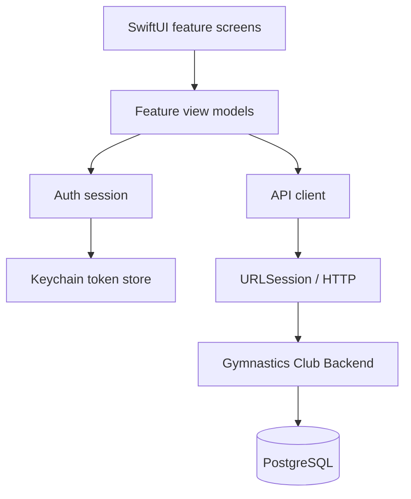

# Application architecture

## High-level flow

## Boundaries

- **Features** own user-facing workflows and feature-specific state.
- **Core/DesignSystem** owns shared presentation primitives and visual tokens.
- **Core/Networking** owns transport, endpoint definitions, typed errors, authentication session behavior, and token persistence.
- **Models** define the Codable contract consumed by the client.

## Session lifecycle

The authentication gate is driven by the session layer. Login establishes a bearer-token session; authenticated API calls attach the token; logout requests server-side revocation and clears local session state. Offline logout must communicate when remote revocation could not be confirmed.

## Data ownership

The backend is authoritative for validation, authorization, capacity, and persistence. The iOS client provides responsive workflows and input feedback but must not be treated as the enforcement boundary.
